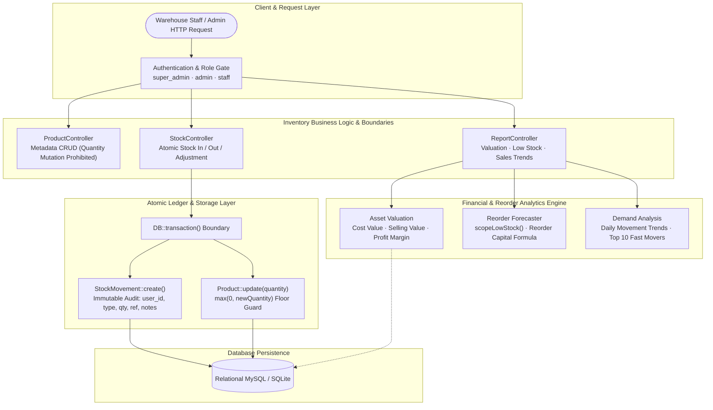

<div align="center">

# 📦 Basic Inventory — Enterprise Inventory & Stock Management Architecture
### *Atomic Ledger Transactions, Financial Valuation, Reorder Forecasting & Role-Based Control*

[](https://www.php.net)
[](https://laravel.com)
[](https://laravel.com)
[](https://laravel.com)
[](https://laravel.com)

<p align="center">
  <b>This repository is a curated technical showcase highlighting core software engineering solutions, atomic ledger integrity, financial asset valuation, and domain implementations from the Basic Inventory management platform.</b>
</p>

</div>

---

## 🧭 About This Showcase

Rather than presenting standard framework boilerplate or redundant dependencies, this repository focuses strictly on **production-grade engineering logic, architectural patterns, and real-world problem solving**.

**Basic Inventory** is a high-reliability inventory and warehouse management system designed to eliminate stock shrinkage, provide real-time asset valuation, automate reorder capital forecasting, and enforce immutable audit trails across multi-tier warehouse operations.

Below is an exhaustive breakdown of the business challenges encountered, the engineering solutions designed, and the exact files in this repository that implement them.

---

## 📊 Problem-to-Code Solution Matrix

| # | Engineering Problem | Solution Pattern | Core Files / Implementation |
| :--- | :--- | :--- | :--- |
| **1** | **Stock Discrepancies & Ledger Race Conditions** | Atomic `DB::transaction` + Immutable Movement Ledger | [`app/Http/Controllers/StockController.php`](app/Http/Controllers/StockController.php)<br>[`app/Models/StockMovement.php`](app/Models/StockMovement.php)<br>[`app/Models/Product.php`](app/Models/Product.php) |
| **2** | **Unauthorized Direct Stock Alteration & Shrinkage** | Strict Architectural Separation of Concerns | [`app/Http/Controllers/ProductController.php`](app/Http/Controllers/ProductController.php)<br>[`app/Http/Controllers/StockController.php`](app/Http/Controllers/StockController.php) |
| **3** | **Critical Stockouts & Working Capital Estimation** | Declarative Low-Stock Scope + Reorder Valuation Math | [`app/Models/Product.php`](app/Models/Product.php)<br>[`app/Http/Controllers/ReportController.php`](app/Http/Controllers/ReportController.php)<br>[`resources/views/reports/low-stock.blade.php`](resources/views/reports/low-stock.blade.php) |
| **4** | **Inventory Asset Visibility & Profitability Tracking** | Multi-Metric Real-Time Financial Valuation Engine | [`app/Http/Controllers/ReportController.php`](app/Http/Controllers/ReportController.php)<br>[`resources/views/reports/inventory-valuation.blade.php`](resources/views/reports/inventory-valuation.blade.php) |
| **5** | **Sales Velocity & Product Demand Trend Analytics** | Outbound Stock Movement Aggregation Engine | [`app/Http/Controllers/ReportController.php`](app/Http/Controllers/ReportController.php)<br>[`resources/views/reports/sales-summary.blade.php`](resources/views/reports/sales-summary.blade.php) |
| **6** | **Privilege Escalation & Self-Deletion Hazards** | Granular RBAC with Defensive Policy Gates | [`app/Policies/UserPolicy.php`](app/Policies/UserPolicy.php)<br>[`app/Models/User.php`](app/Models/User.php)<br>[`app/Http/Controllers/UserController.php`](app/Http/Controllers/UserController.php) |
| **7** | **High-Speed SKU Lookup & Relational Efficiency** | Indexed SKU Uniqueness + Eager Loaded Relations | [`database/migrations/2026_01_17_100003_create_products_table.php`](database/migrations/2026_01_17_100003_create_products_table.php)<br>[`app/Http/Controllers/ProductController.php`](app/Http/Controllers/ProductController.php) |

---

## 🔎 Technical Deep Dives: Problems & Code Solutions



---

### Problem 1: Stock Discrepancies & Ledger Race Conditions
- **The Challenge**: In high-throughput warehouse environments, simultaneous dispatches, arrivals, and manual counts frequently lead to race conditions. When stock counts are modified without an immutable record, inventory counts desynchronize from physical reality, making it impossible to identify whether missing units were sold, damaged, or lost to shrinkage.
- **The Architectural Solution**: Built an **ACID-compliant atomic ledger transaction pipeline** via `DB::transaction()` in `StockController::store()`.
  - Every single inventory adjustment writes an immutable `StockMovement` entry capturing the acting operator (`user_id`), transaction type (`in`, `out`, `adjustment`), quantity, reference voucher/PO number, and audit notes.
  - Concurrently updates the live `Product` balance within the exact same database transaction boundary.
  - Enforces a mathematical zero-floor constraint (`max(0, $newQuantity)`) preventing negative inventory states.
- **Code Highlights**:
  - [`app/Http/Controllers/StockController.php`](app/Http/Controllers/StockController.php): Atomic transaction handling all three movement types (`in`, `out`, `adjustment`).
  - [`app/Models/StockMovement.php`](app/Models/StockMovement.php): Explicit movement type constants and user/product relationship definitions.

---

### Problem 2: Unauthorized Direct Stock Alteration & Shrinkage Prevention
- **The Challenge**: If general product update forms allow directly editing the `quantity` input, staff or catalog editors can casually alter on-hand counts without leaving an operational trace. This creates severe fraud vulnerability and invalidates warehouse auditing.
- **The Architectural Solution**: Enforced a strict **Architectural Separation of Concerns**:
  - `ProductController::update()` explicitly omits `quantity` from the validated payload. Catalog editors can update product names, SKUs, descriptions, pricing, and suppliers, but *cannot* alter stock counts.
  - The *only* way to mutate product inventory is via the dedicated `StockController::store()` action, which mandates audit reasons and logs the operator.
- **Code Highlights**:
  - [`app/Http/Controllers/ProductController.php`](app/Http/Controllers/ProductController.php): `update()` validates only metadata, deliberately preventing direct quantity overwrites.
  - [`resources/views/products/form.blade.php`](resources/views/products/form.blade.php): Restricts initial quantity setup to creation mode only.

---

### Problem 3: Critical Stockouts & Working Capital Reorder Forecasting
- **The Challenge**: Stockouts directly cost businesses sales, while excessive reorders trap critical working capital. Standard inventory systems merely highlight low stock, leaving procurement managers to manually calculate how much cash is needed to restock warehouse shelves.
- **The Architectural Solution**: Engineered a dynamic **Reorder Capital Forecaster** backed by declarative Eloquent scopes:
  - **Declarative Query Scope**: `Product::scopeLowStock()` automatically filters items where `quantity <= min_stock_level` and `min_stock_level > 0`.
  - **Critical Stockout Isolation**: `ReportController::lowStock()` isolates items with zero remaining stock (`quantity == 0`) for emergency replenishment.
  - **Financial Reorder Formulation**: Computes the exact capital expenditure required to restore target inventory levels:
    `Total Reorder Capital = SUM((min_stock_level - quantity) * cost_price)`
- **Code Highlights**:
  - [`app/Models/Product.php`](app/Models/Product.php): `scopeLowStock()` query scope and `isLowStock()` helper.
  - [`app/Http/Controllers/ReportController.php`](app/Http/Controllers/ReportController.php): Dynamic computation of `total_reorder_value` and `critical_items`.
  - [`resources/views/reports/low-stock.blade.php`](resources/views/reports/low-stock.blade.php): Executive visual summary with urgency badges.

---

### Problem 4: Inventory Asset Visibility & Real-Time Financial Valuation
- **The Challenge**: Management often lacks visibility into total balance-sheet capital tied up in the warehouse, unrealized profit potential, and category-level asset distribution.
- **The Architectural Solution**: Created a real-time **Multi-Metric Financial Valuation Engine** in `ReportController::inventoryValuation()`:
  - **Total Cost Valuation**: `SUM(quantity * cost_price)` &mdash; reflects real capital tied up in physical inventory.
  - **Total Retail Potential**: `SUM(quantity * selling_price)` &mdash; reflects gross revenue capacity upon liquidation.
  - **Unrealized Profit Margin**: `SUM(quantity * (selling_price - cost_price))` &mdash; provides accurate margin forecasting.
  - **Category-Level Drill-Down**: Supports instant category filtering to assess capital allocation across product domains.
- **Code Highlights**:
  - [`app/Http/Controllers/ReportController.php`](app/Http/Controllers/ReportController.php): Comprehensive valuation aggregations.
  - [`resources/views/reports/inventory-valuation.blade.php`](resources/views/reports/inventory-valuation.blade.php): Detailed tabular and card breakdown.

---

### Problem 5: Sales Velocity & Product Demand Trend Analytics
- **The Challenge**: Fast-moving consumer goods (FMCG) businesses need to identify top-performing SKUs and daily sales throughput without having to install and maintain an expensive, complex full ERP / POS system.
- **The Architectural Solution**: Developed an **Outbound Movement Analytics Pipeline**:
  - Directly aggregates outbound stock movements (`type = 'out'`) across customizable date intervals.
  - Generates daily volume throughput graphs using `DATE(created_at)` database groupings.
  - Identifies the Top 10 Fast-Moving SKUs ranked by total units dispatched (`orderByDesc('total_sold')`).
  - Estimates realized revenue yield dynamically: `SUM(outbound_quantity * selling_price)`.
- **Code Highlights**:
  - [`app/Http/Controllers/ReportController.php`](app/Http/Controllers/ReportController.php): `salesSummary()` daily aggregations and top SKU extraction.
  - [`resources/views/reports/sales-summary.blade.php`](resources/views/reports/sales-summary.blade.php): Throughput analytics and transaction counts.

---

### Problem 6: Privilege Escalation & Self-Deletion Protection
- **The Challenge**: Operating staff must be able to log day-to-day warehouse movements without accessing sensitive company user profiles, modifying employee privileges, or accidentally deleting accounts.
- **The Architectural Solution**: Designed a decoupled, 3-tier **Role-Based Access Control (RBAC)** architecture enforced via `UserPolicy`:
  - **Hierarchical Roles**: `super_admin`, `admin`, and `staff`.
  - **Administrative Barrier**: User management routes (`/users`) are locked strictly to `super_admin`.
  - **Defensive Self-Deletion Barrier**: In `UserPolicy::delete()`, super-admins are explicitly blocked from deleting their own active profile (`$user->id !== $model->id`), preventing catastrophic lockout.
- **Code Highlights**:
  - [`app/Policies/UserPolicy.php`](app/Policies/UserPolicy.php): Role checks and defensive `$user->id !== $model->id` self-deletion block.
  - [`app/Models/User.php`](app/Models/User.php): Role constants and helper methods (`isSuperAdmin()`, `isAdmin()`).
  - [`app/Http/Controllers/UserController.php`](app/Http/Controllers/UserController.php): Policy enforcement and validation.

---

### Problem 7: High-Speed SKU Lookup & Relational Efficiency
- **The Challenge**: As warehouse catalogs scale to thousands of SKUs, non-indexed lookups and unoptimized relational queries cause search latency, slow pagination, and high database CPU usage.
- **The Architectural Solution**:
  - **Unique SKU Indexing**: Enforced database-level unique constraints on `sku` (`$table->string('sku', 50)->unique()`), guaranteeing sub-millisecond barcode/SKU searches.
  - **Eager Loading Optimization**: Eager loads relational dependencies (`with(['category', 'supplier', 'stockMovements'])`) across controllers to completely prevent N+1 query overhead.
- **Code Highlights**:
  - [`database/migrations/2026_01_17_100003_create_products_table.php`](database/migrations/2026_01_17_100003_create_products_table.php): Indexing and decimal precision casting.
  - [`app/Http/Controllers/ProductController.php`](app/Http/Controllers/ProductController.php): Search scoping and eager-loaded pagination.

---

## 🗂 Curated Repository Structure

```
basic_inventory_git/
├── README.md                          # Engineering showcase & problem-solving deep dive
├── app/                               # Core Application & Business Logic
│   ├── Http/
│   │   ├── Controllers/               # Resource controllers (Products, Stock, Reports, etc.)
│   │   │   └── Auth/                  # Authentication controllers
│   │   └── Requests/                  # Form request validation
│   ├── Models/                        # Eloquent models (Product, StockMovement, Category, Supplier, User)
│   ├── Policies/                      # Authorization policies (UserPolicy with self-deletion guard)
│   ├── Providers/                     # Service providers
│   └── View/Components/               # Reusable UI layout components
│
├── database/                          # Relational Database Architecture
│   ├── factories/                     # Model factories for testing
│   ├── migrations/                    # Schema migrations with unique SKU constraints
│   └── seeders/                       # Database seeders with realistic demo stock data
│
├── resources/                         # Presentation Layer
│   ├── css/ & js/                     # Tailwind CSS & Alpine.js scripts
│   └── views/                         # Blade templates & layouts
│       ├── categories/                # Category management views
│       ├── components/                # Reusable UI elements & modal dialogs
│       ├── layouts/                   # App and guest layouts
│       ├── products/                  # Product catalog, stock details, and forms
│       ├── profile/                   # User profile views
│       ├── reports/                   # Executive reporting dashboards (Valuation, Low Stock, Sales)
│       ├── stock/                     # Stock adjustment forms & movement history
│       ├── suppliers/                 # Supplier directory views
│       └── users/                     # Super-admin user management views
│
├── routes/                            # Route Definitions
│   ├── auth.php                       # Authentication routes
│   ├── console.php                    # CLI routes
│   └── web.php                        # Inventory resources, stock adjustments & reports
│
└── tests/                             # Automated Test Suites
    ├── Feature/                       # Feature tests (Auth, Profile)
    └── Unit/                          # Unit tests
```

---

## 💡 Engineering Highlights for Evaluators

When reviewing this codebase, please note the following technical decisions:

1. **Transactional Integrity**: No inventory count is ever incremented or decremented without an accompanying atomic `StockMovement` ledger entry inside a `DB::transaction()` block.
2. **Defensive Separation of Concerns**: Product catalog data and physical stock quantities are decoupled; catalog updates cannot silently alter inventory quantities.
3. **Data-Driven Capital Allocation**: The system transforms basic stock tracking into financial intelligence by dynamically calculating reorder capital requirements and unrealized inventory profits.
4. **Architectural Simplicity & Maintainability**: Clean MVC design pattern using native framework primitives without unnecessary bloat or unvetted third-party packages.

---

## 👨‍💻 Author & Contact

Developed by **Rahul**  
- **Focus**: Full-Stack Web Development, Enterprise System Architecture, Laravel & Modern Cloud Solutions  
- **Inquiries**: Feel free to connect for technical discussions and engineering opportunities!
